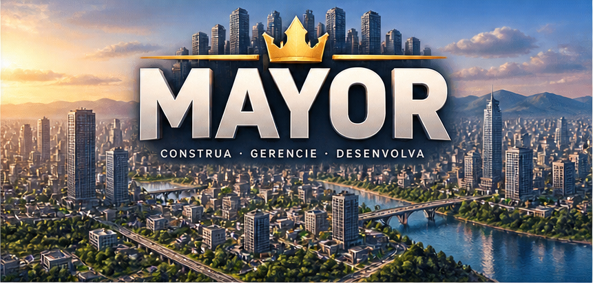
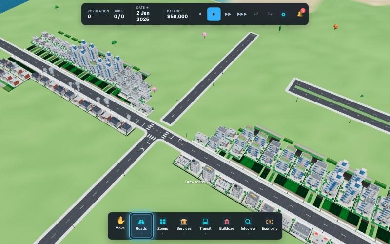
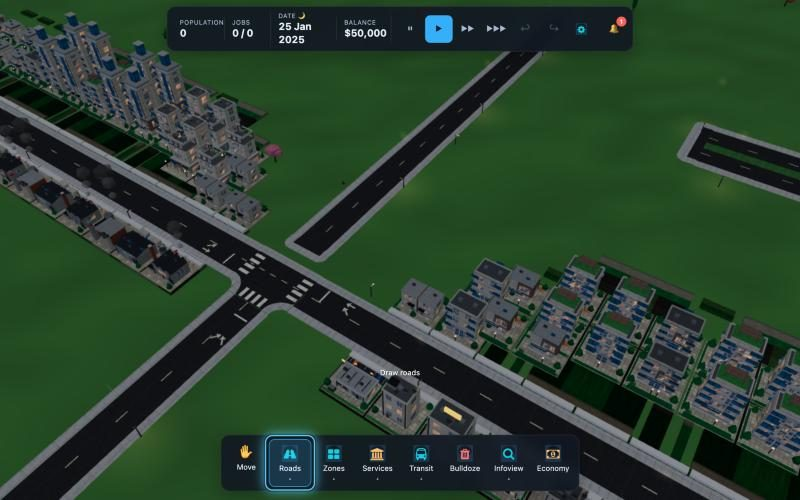
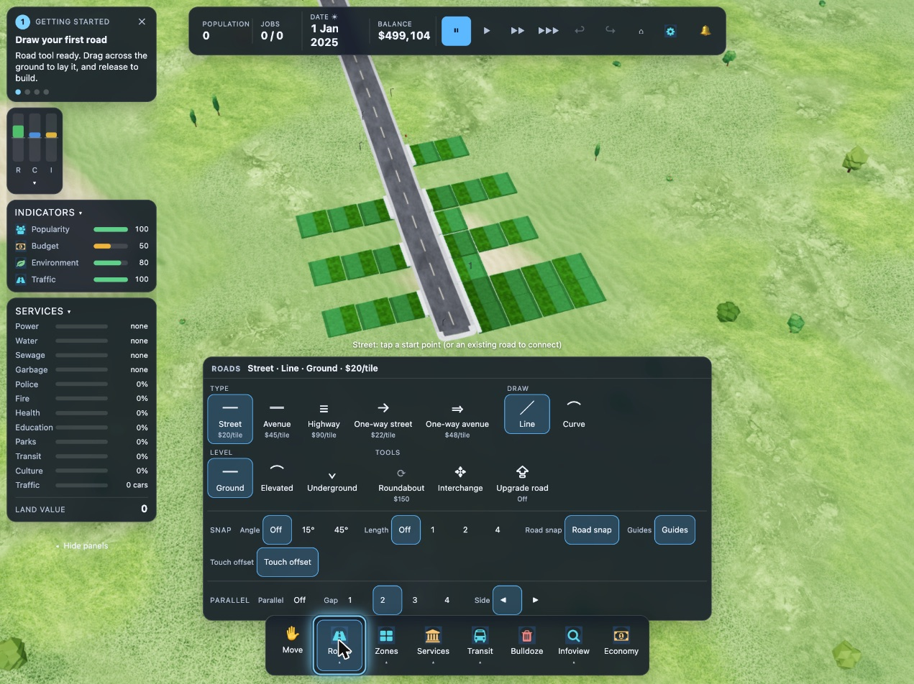
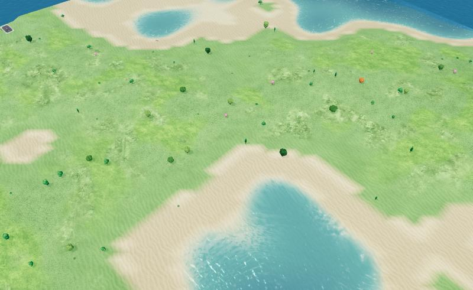
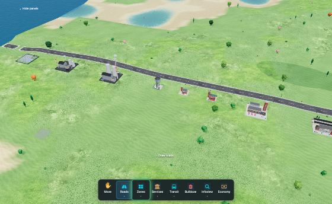

# Mayor



Mayor is an original city builder inspired by Cities: Skylines. It runs as a native iPad app (Tauri 2, in App Store
review), as a signed and notarized Mac app, and in the browser (paid web demo or the PWA bundle). The game ships in
pt-BR by default with an English option, and plays fully offline.

Mayor focuses on the playable city-building loop: terrain, roads, zoning, lots, utilities, traffic, transit, water,
saves. It is not a feature-parity clone of Cities: Skylines II; it is its own small, inspectable city builder built with
TypeScript, Three.js, Vite and a pure TypeScript simulation. It contains no code, art or names from other games.

| Day | Night |
|---|---|
|  |  |

## Get Mayor

| Platform | Channel | State (2026-10-15) |
|---|---|---|
| iPad | App Store ("Mayor: Construtor de Cidades", bundle `com.gutnik.mayor`, iPad only, free) | Build 3 in review; build 4 in TestFlight (internal). See [docs/IOS.md](docs/IOS.md) and [docs/appstore/APPSTORE.md](docs/appstore/APPSTORE.md). |
| Mac (Apple Silicon) | [GitHub release v0.1.0-m35](https://github.com/wsgutnik/mayor/releases/tag/v0.1.0-m35): Developer ID signed, notarized dmg | Released 2026-10-14 |
| Browser | [mayor-demo.vercel.app](https://mayor-demo.vercel.app): landing page and paid web demo ($4.99 one-time) | Live; ops in [docs/WEB-DEMO.md](docs/WEB-DEMO.md) |
| iPad (PWA) | `Mayor-m35-ipad-pwa.zip` in the same GitHub release, or `npm run dev` on the local network | Fallback |
| Windows | Tauri config only | Not built |

## Features

| Area | What is in the game |
|---|---|
| Roads and junctions | Line and Curve drawing; street, avenue, highway, one-way, roundabout, bridge, tunnel, overpass, underpass, interchange; upgrade in place (widening clears empty zoned cells, refuses over buildings). Snapping with a constant pixel radius, world and road-relative angle guides, refusals with reasons (duplicate, overlapping or sharply crossing roads). Junctions with sidewalks wrapping corners, crosswalks, stop bars, lane arrows and a lane graph. |
| Touch | iPad-first road tool: anchor marker with snap ring, draft point 56 px above the finger with a tether, 450 ms long-press cancel, reset-view button; flyouts close on a map tap; pinch, pan, twist. |
| Tools and menus | One tool-state reducer; Roads, Services, Zones and Transit flyouts in sections with a live summary, costs, usage numbers and disabled reasons ([docs/process/25-tool-state.md](docs/process/25-tool-state.md)). |
| Zoning and lots | Street-aligned R/C/I zoning up to 4 cells deep (the only mode); cells validated against the physical road surface, never under asphalt, always attached to the street; lots packed by dynamic programming and evolving from 1x1 to 4x4; 8 rare landmarks. |
| Services and utilities | Power, water and sewage flow along roads with capacity; police, fire, health, education, parks, city hall, garbage; small/base/large tiers (solar, large power, water tower, large water, fire post, fire HQ). Service buildings snap to the street frame and show how many lots, residents and jobs they serve in the build tooltip and the inspector. Underground view (`U`). |
| Traffic and transit | A* routes, IDM car-following, lanes through junctions, unsignalised priority (main road, yield to the right, left-turners yield), adaptive signals, gridlock watchdogs; buses, metro, rail and train stations, lines, fares. |
| City life | Construction stages, residents by age group, employment rate, statistics panel, land value, demand bars, bell notifications, onboarding card. |
| Look | Blender-built GLB kit (40 base buildings, x2/x4 evolved models, landmarks, service tiers, 36 vehicle models, props), CC0 textures, per-biome ground textures, low-poly pack trees, volumetric clouds, HDRI day/night with per-window lights and light pools, water with shoreline and foam. |
| Saves | Three slots, monthly autosave, import/export, structural validation and old-save migration. |
| App shell | About and credits screen (licences, privacy line), pt-BR/English, quality settings, offline PWA. |

| Menus | Terrain | Services |
|---|---|---|
|  |  |  |

## Quick Start

```bash
npm install
npm run dev     # http://localhost:5173 (also on the local network for iPad testing)
npm test        # simulation rules
npm run build   # types + bundle in dist/
```

Local checks (no GitHub Actions; everything runs locally):

```bash
npx tsc --noEmit
npx vitest run --exclude '.claude/**'          # 968 passing, 3 skipped, 2 todo (117 files) at db6c2d9
npx vitest run src/sim/showcase-gate.test.ts   # headless junction gate
npm run ci                                     # types, tests, build
bash scripts/appstore-prereq-check.sh          # App Store readiness table
```

Dev-only URLs: junction showcase `?showcase=1`; scripted touch scenario `?scenario=upgrade&lockcam=1` (add
`&built=1` for built lots). Procedural buildings (experimental, rejected visually): `?procBuildings=1`.

Build Blender assets:

```bash
blender -b --factory-startup --python blender/build_all.py -- --out public/models --previews docs/img/models
```

## Controls

| Action | Mouse | Touch |
|---|---|---|
| Use tool | left button (zones: drag to paint; roads: click start and end, or start, bend and end) | one finger (roads: tap the anchor, drag; the draft point sits above the finger) |
| Cancel road | Esc | Finish road button, or hold still 450 ms |
| Move camera | right button, WASD/arrows | Move tool, or two fingers |
| Rotate | middle button, Q/E | two fingers (twist) |
| Zoom | wheel | pinch |
| Reset view | - | reset-view button |
| Underground view | `U` (or Maps → Underground) | Maps → Underground |
| Undo / Redo | `Ctrl/Cmd+Z`, `Ctrl/Cmd+Shift+Z` or `Ctrl+Y` | ↩ ↪ buttons in the top bar |
| Hide HUD panels | `H` | Hide panels button |
| Suspend guides / snapping | hold `Shift` (guides), `Alt`/`Option` (snapping) while drawing | Guides toggle |

## Project Layout

| Path | Purpose |
|---|---|
| `src/sim/` | Pure simulation: world state, road graph, zoning and lots, utilities, facility placement and usage, traffic, transit, saves, tests |
| `src/render/` | Three.js renderer: terrain, roads, lots, water, underground view, GLB models, clouds, picking, camera |
| `src/ui/` | DOM/CSS HUD, tool-state reducer, touch road tool, menus, inspector, credits; strings through `src/i18n.ts` |
| `src/dev/` | Dev-only showcase and scenarios |
| `src-tauri/` | Tauri shell: Mac config, `tauri.ios.conf.json`, generated Xcode project in `gen/apple/` |
| `blender/` | Procedural model and texture pipeline, previews and GLB export |
| `public/` | Runtime assets: models, textures, maps, icons, service worker, manifest |
| `third_party/` | CC0 sources and project-internal art packs |
| `docs/` | Status, changelog, install/signing/iOS/App Store/web demo docs, process designs, images |

## Documentation

- [docs/STATUS-2026-10-15.md](docs/STATUS-2026-10-15.md): current state on one page, open items with owners.
- [docs/CHANGELOG.md](docs/CHANGELOG.md): every change since M35 with commit hashes and tests.
- [PROGRESS.md](PROGRESS.md) and [PLAN.md](PLAN.md): milestones, measured numbers, decisions, next items.
- [docs/IOS.md](docs/IOS.md): iPad toolchain, dev installs, signed builds and upload. [docs/appstore/](docs/appstore/): App Store runbook, metadata, privacy, review notes.
- [docs/SIGNING.md](docs/SIGNING.md): Mac signing and notarization. [docs/INSTALL.md](docs/INSTALL.md): installation notes.
- [docs/WEB-DEMO.md](docs/WEB-DEMO.md): web demo site, Stripe settings, deploy and test checklist.
- [docs/process/README.md](docs/process/README.md): index of the design and research documents (01 to 25).
- [docs/GROWTH-PLAN.md](docs/GROWTH-PLAN.md), [docs/UI-V2-PLAN.md](docs/UI-V2-PLAN.md), [docs/ASSET-ARCHITECTURE-V2.md](docs/ASSET-ARCHITECTURE-V2.md), [docs/VISUAL-UPGRADE-ROADMAP.md](docs/VISUAL-UPGRADE-ROADMAP.md): roadmaps.
- [NOTICE.md](NOTICE.md): licensing, trademarks and third-party material. [third_party/README.md](third_party/README.md): source asset inventory.

## Status

| Area | Status |
|---|---|
| M1-M21, M23-M28 | done: core loop, services, roads, traffic, transit, saves, packaging, visual kit, water, rendering, bridges and tunnels, level separation, zone rules, street-aligned zoning, visual assets |
| Junction builder, priority, adaptive signals | done |
| Zone integrity and performance | done (zones never under roads; reconcile 46-188 ms -> under 8 ms per edit on 96x96) |
| Lot evolution, demographics, landmarks | done |
| Catalog 41-84, rail, service tiers | done in the sim; most 41-84 models missing (procedural fallback) |
| Touch road tool, tool-state reducer, menus | done; touch tested on the simulator only |
| Mac 0.1.0 (M35) | released, signed and notarized |
| iPad App Store | in review (build 3), TestFlight build 4 |
| Web demo | live |
| M22 | pending: walking pedestrians, Windows build, real-hardware profiling |

Open items: [docs/STATUS-2026-10-15.md](docs/STATUS-2026-10-15.md#open-items-and-gaps).

## License and Trademarks

Mayor is original work inspired by city-builder conventions. It is not affiliated with, sponsored by, or endorsed by Paradox Interactive or Colossal Order. Cities: Skylines and Cities: Skylines II names belong to their owners. See [NOTICE.md](NOTICE.md) for the current code-license status, third-party materials, and trademark notice.
