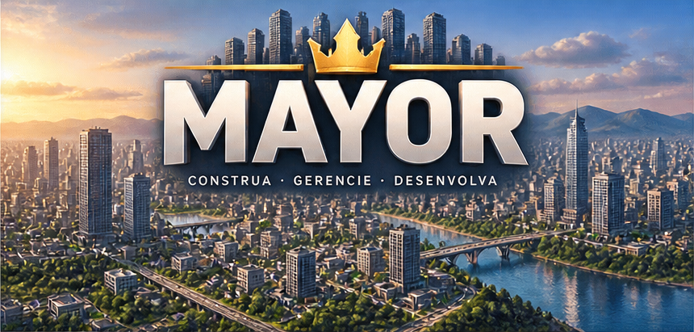

# Mayor



Clone jogável de city builder inspirado em Cities: Skylines II. Mac, Windows e iPad (PWA).
Plano e marcos: [PLAN.md](PLAN.md).

```bash
npm install
npm run dev     # http://localhost:5173 (também na rede local, para abrir no iPad)
npm test        # regras da simulação
npm run build   # tipos + bundle em dist/
```

- M11: modelos 3D procedurais (casas, blocos, torres de vidro, galpões, fábricas) e instalações; janelas por textura que acendem à noite; prédios viram para a rua.

- M12: mapas oficiais do Map Kit (Baía Metropolitana, Vale Verde, Arquipélago Azul, Planície Central), baixados para 128×128 por
  `npm run maps` (decodifica o PNG de 16 bits, calcula a entrada de cada mapa) e escolhidos no menu. O motor aceita mapas de qualquer
  tamanho e entrada em qualquer borda.

- M13: Kit de Prédios Básicos (40 prédios). Catálogo com nomes e categorias do kit (R1-R5, C1-C4, I1-I4, serviços e utilidades),
  um modelo 3D por prédio, sete instalações novas (hospital, escola secundária, biblioteca, centro comunitário, museu, prefeitura,
  subestação) e cartão de inspeção ao tocar num prédio com a ferramenta Mover, com a miniatura do kit.

## Controles

| | Mouse | Toque |
|---|---|---|
| Usar ferramenta | botão esquerdo (arrastar pinta; Linha/Curva: clique) | um dedo (Linha/Curva: toque) |
| Cancelar estrada | Esc | botão Finish road |
| Mover câmera | botão direito, WASD/setas | ferramenta Move, ou dois dedos |
| Girar | botão do meio, Q/E | dois dedos (torcer) |
| Zoom | roda | pinça |

## Status

- M1: terreno, estradas, zonas R/C/I, bulldoze, crescimento por demanda, impostos e orçamento.
- M2: usina, bomba d'água, esgoto e aterro com cobertura por raio, infoviews e painel de serviços.
  Prédios novos precisam de energia e água; nível 2 pede esgoto, nível 3 pede coleta de lixo.
- M3: polícia, bombeiros, clínica, escola e parque; incêndios, felicidade e mapa de valor do solo.
  Sem estação de bombeiros um prédio pode pegar fogo; nível 3 exige escola; valor do solo escala a arrecadação.
- M4: estradas livres. Toque ou clique inicio e fim (Linha) ou inicio, curva e fim (Curva); Pintar continua disponível.
  Rua, avenida e rodovia (a rodovia liga mas não serve lotes); snapping em estradas existentes.
  A simulação continua em grade: cada via é rasterizada em tiles, então zonas, cobertura e conectividade seguem iguais.
- M5: tráfego. Carros de moradores (casa para emprego) e caminhões (indústria para comércio) percorrem a rede
  com A* sensível a congestionamento; cada classe de via tem velocidade e capacidade; infoview de tráfego;
  congestionamento reduz felicidade.
- M6: transporte público. Paradas de ônibus (em ruas e avenidas) e estações de metrô (em qualquer terreno livre);
  linhas circulares criadas tocando as paradas em ordem; ônibus usam as vias e entram no tráfego, trens vão em linha reta.
  Passageiros pagam tarifa, tiram carros da rua, elevam o valor do solo e a felicidade. Painel de linhas com veículos e remoção.
- M7: menu (☰) com 3 slots de save, autosave mensal, nova cidade por seed; ciclo dia e noite com janelas acesas;
  chuva (determinística por dia e seed) que deixa o trânsito 15% mais lento. Saves ficam em localStorage (~90 KB).
- M8: empacotamento. PWA com service worker (offline), ícones e manifest; app de Mac com Tauri (`npm run desktop:build`,
  `.app` de 10 MB e `.dmg` de 3 MB); exportar e importar saves por arquivo; resolução adaptativa e reconstrução da cena
  limitada a uma vez a cada 80 ms para aliviar GPUs mais fracas. Instruções para iPad e Windows em [docs/INSTALL.md](docs/INSTALL.md).
- M9: identidade visual a partir da folha de marca. Banner e ícone do app, ícones do HUD recortados da folha,
  barra de ferramentas reagrupada (Estradas, Zonas, Serviços, Transporte, Demolir, Mapas, Economia),
  painel de indicadores (Popularidade, Orçamento, Meio ambiente, Tráfego), preferências (idioma pt-BR/en,
  qualidade gráfica, dicas, autosave, dia/noite) e interface traduzida.
- M10: kit visual (PDF). Ícones coloridos do kit na barra, no HUD e nos mapas; tiles isométricos nas zonas;
  seletor de terreno ao criar cidade (Planície, Floresta, Rio, Litoral, Montanha, Deserto) com árvores e cores próprias;
  preferências em abas (Geral, Gráficos, Jogabilidade, Controles) com Restaurar padrões e Aplicar; ícone do app em alta resolução.
